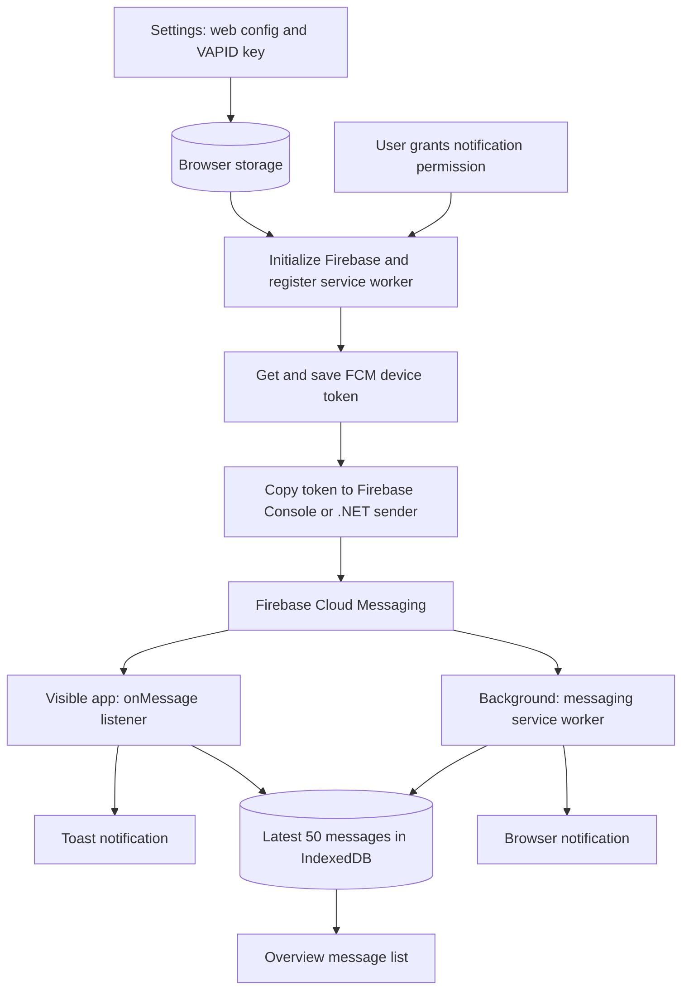

<p></p>

# Next.js Firebase Push Notification Demo

FPND is a browser dashboard for testing Firebase Cloud Messaging (FCM). Configure a Firebase project, register this browser, copy its device token, and inspect received notifications. The app uses the Next.js Pages Router and stores its workspace data in the browser.

[Live app](https://nextjs-firebase-push-notification.vercel.app)

## Overview

- **Overview (`/`)** shows notification permission, the device token, topic subscriptions, and the latest 50 received messages. You can copy the token and clear local message history.
- **Settings (`/settings`)** accepts Firebase web configuration and a VAPID public key, with quick paste support. Service-account JSON is optional and used for topic management.
- **Foreground messages** appear as toast notifications and are saved to history.
- **Background messages** are handled by a service worker and saved to the same history. Browser notifications depend on browser support, permissions, and operating-system settings; delivery with a fully closed browser is not guaranteed.
- The responsive dashboard supports light and dark themes.

The JavaScript app uses Next.js 16, React 19, Firebase 13, LocalForage, React Toastify, and Tailwind CSS. An optional .NET 8 console sender is included in `firebase-test-proj/`.

## Run locally

Requirements: Node.js 20.9 or newer, npm, a Firebase project with Cloud Messaging enabled, and a browser supporting Firebase web messaging, service workers, notifications, and IndexedDB. Use localhost for development or HTTPS when hosted.

```bash
npm install
npm run dev
```

Open [http://localhost:3001](http://localhost:3001). Firebase configuration is entered through Settings; no environment variables are required for this workflow.

For a production build:

```bash
npm run build
npm start
```

The production server also listens on port 3001.

## Setup and testing workflow

### 1. Configure your Firebase project

In [Firebase Console](https://console.firebase.google.com/), open your project settings and register or select a web app. Copy its Firebase web configuration. Under Cloud Messaging, obtain or generate the public key from Web Push certificates.

Open **Settings** in FPND and paste the web configuration or enter the fields manually:

| Field | Required | Purpose |
| --- | --- | --- |
| `apiKey` | Yes | Firebase web API key |
| `authDomain` | Yes | Firebase authentication domain |
| `projectId` | Yes | Firebase project identifier |
| `messagingSenderId` | Yes | FCM sender identifier |
| `appId` | Yes | Firebase web app identifier |
| `vapidKey` | Yes | Web Push public key |
| `storageBucket` | No | Storage bucket; defaults to `<projectId>.appspot.com` |
| `measurementId` | No | Analytics measurement identifier |
| `serviceAccount` | No | Service-account JSON for topic changes only |

Select **Save Configuration**. The app saves the settings, removes the cached device token, and reloads to initialize the selected project.

### 2. Register this browser

Return to **Overview**, select **Enable notifications**, and allow the browser permission prompt. The app registers `/firebase-messaging-sw.js`, requests an FCM registration token using your VAPID key, and saves the token locally. If permission was already granted, the app also attempts to connect when it loads.

Copy the token shown in the dashboard. This identifies this browser registration, not a user account.

### 3. Send a test notification

From Firebase Console's messaging area, compose a notification and use **Send test message** with the copied FCM token.

1. Keep the app visible to check foreground toasts and message history.
2. Switch to another tab or background the app, then send another message to check the service-worker notification path.
3. Return to Overview to inspect the saved messages and their foreground/background labels.

Alternatively, use the included .NET sender:

```bash
cd firebase-test-proj
dotnet run
```

Install the .NET 8 SDK first. Supply your own service-account JSON when prompted, or place it in the console project as `serviceAccountKey.json`. Follow the prompts for a title, body, device token, optional image/click URL, and confirmation. This sender targets a device token. Never commit the credential file.

### 4. Manage topics (optional)

Add service-account JSON for the same Firebase project in **Settings**. Once the browser has a token, enter a topic on Overview and select **Add**; use **Remove** to unsubscribe.

The browser sends `{ token, topic, serviceAccount }` to `/api/topics`: `POST` subscribes and `DELETE` unsubscribes. The API obtains a Google access token and calls Google's topic-management endpoints. The local topic list changes only after a successful response. It is a locally maintained record, not a live query of server subscriptions. Send topic-targeted messages using a separate trusted backend or sender.

## How messages move through the app



`PushNotificationLayout` attaches the foreground listener and refreshes the dashboard through browser events. The service worker reads configuration from IndexedDB, records background messages, and signals open tabs to refresh. Firebase displays notification payloads automatically; the worker explicitly displays a notification for data-only messages.

## Local data and credential handling

LocalForage stores these keys, normally in IndexedDB:

| Key | Contents |
| --- | --- |
| `firebase_config` | Web configuration, VAPID key, and optional service-account JSON |
| `fcm_token` | Cached browser registration token |
| `fcm_subscribed_topics` | Locally recorded topic subscriptions |
| `notification_history` | Latest 50 received messages |

The theme preference is stored separately in localStorage under `theme`. Data belongs to the current browser profile and origin; it is not synchronized between devices.

Clearing configuration removes `firebase_config` and `fcm_token`, while preserving topic records and message history. Clearing history removes only the saved messages. Neither action sends a topic-unsubscribe request. After changing projects or clearing browser data, obtain a fresh token and verify your subscriptions.

**This is a development demo.** Service-account JSON contains a private key: when configured here, it is stored in the browser and sent to this app's server for topic changes. Use test credentials on a trusted device and server. The topic API has no application-level authentication. Production use requires server-side credential storage and authenticated, authorized topic management. Do not commit credentials.

## Project structure

```text
components/
  FirebaseConfigForm.js       Settings form, persistence, and reset
  PushNotificationLayout.js  Shared navigation, themes, and foreground listener
pages/
  index.js                   Dashboard, device permission, history, and topics
  settings.js                Settings page
  _app.js                    Global styles and application wrapper
  _document.js               Document metadata and theme initialization
  api/topics.js              Topic subscribe/unsubscribe endpoint
  api/hello.js               Sample API endpoint
public/
  firebase-messaging-sw.js   Background messaging and history persistence
  logo.svg                   Master logo; generated assets live alongside it
utils/
  firebase.js                Firebase initialization, token, and topic storage
  notification-url.mjs       URL validation for dashboard message links
firebase-test-proj/           Optional .NET 8 device-token sender
scripts/generate-brand.cjs    Branding asset generator
tests/                       Node tests for URLs, service worker, and branding
```

## Development workflow

Read [rules.md](rules.md) before changes. Preserve the Pages Router and existing browser storage keys. For Next.js changes, read the relevant installed guides in `node_modules/next/dist/docs/`.

```bash
npm run lint
npm test
npm run build
```

Keep the Firebase browser dependency and service-worker SDK versions aligned. When changing dependencies, keep dependency manifests and lockfiles consistent. Matching npm overrides and Yarn resolutions currently pin Firestore's transitive `@grpc/grpc-js` dependency to `1.13.6` and the TypeScript ESLint parser's `minimatch` dependency to `11.0.1`. These address upstream security advisories; review and remove each override when its parent dependency supports a patched release.

## Troubleshooting

- **No token:** save the web configuration and VAPID public key, enable notifications, and inspect the browser console for initialization errors. The service account cannot replace the web configuration.
- **Permission denied:** change the site's notification permission in browser settings, then reload and reconnect.
- **Service worker unavailable:** use HTTPS or localhost and inspect browser DevTools → Application → Service Workers. Check that the worker script and Firebase SDK scripts load successfully.
- **No background notification:** check browser/OS notification settings, service-worker status, and that the sender uses a current token for the same Firebase project.
- **Topic request fails:** confirm that Settings includes valid service-account JSON for the intended project, then inspect the `/api/topics` response. A valid device token is also required.
- **Old messages or topics after changing projects:** these are browser-local records retained independently of configuration. Clear history or review subscriptions as appropriate.

## Branding

The original FPND mark combines a notification bell, message bubble, and unread signal in Firebase orange (`#FF9100`) and amber (`#FFC400`). No external logo artwork was copied; existing project attribution is retained.

Edit [public/logo.svg](public/logo.svg), then run `npm run generate:brand` to regenerate the transparent [PNG logo](public/logo.png), favicons, Apple icon, app and maskable icons, monochrome notification badge, and social card. The script uses Sharp installed with Next.js.

## References

- [Next.js documentation](https://nextjs.org/docs)
- [Firebase Cloud Messaging documentation](https://firebase.google.com/docs/cloud-messaging)

## License

MIT
